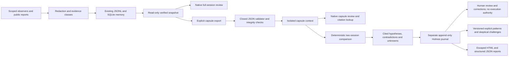

# Cognitive observatory: working boundary and staged extension

APM remains one local-first Python/Tk product. Observation and SQLite memory are
working foundations; portable evidence and deterministic comparison now add a
small, executable investigation boundary. This is not a finished forensic or
federated intelligence platform.

## Component contracts

| Layer | Working implementation | Extension boundary |
|---|---|---|
| Observation | Existing scoped host/Genesis adapters, public Codex reports, redaction, bounded receiver | Each new adapter must declare access scope, schema/version, producer identity limits, clocks, resource caps and blind spots; no automatic discovery of private data |
| Episodic memory | Existing receipt-chain SQLite, sessions, saved findings/notes and passive JSONL replay | Keep original records immutable; future typed relationships belong in versioned derived records with citations, not rewritten observations |
| Evidence exchange | `apm.evidence.capsule`: explicit disclosure, validation and read-only context | No database insertion, network fetch, archive extraction, execution, signing or automatic trust |
| Investigation | `apm.evidence.compare` and `apm.holmes`: scoped hypotheses, append-only reviews, challenges, versioned exact-match patterns and reports | Pattern promotion UI, validation registry, broader ground-truth retrieval evaluation and stronger claim analysis remain future work |
| Human interface | Existing microscope and Memory/Ask, full-session qualification review, capsule viewer/comparison, functional Holmes Lab | Opinions remain records; no action-grant mechanism exists |
| Cooperation/federation | Offline bounded assessment validator and synthetic local demonstration | Real providers, authenticated agents, transport and federation remain unimplemented |

The exchange/investigation modules use the standard library and existing APM
code. psutil remains the sole application dependency. No optional provider,
forensic framework, signing library or network service is a startup prerequisite.
Existing schemas need no migration for this slice. Separate repositories are
premature until API ownership, release cadence and compatibility tests justify
them; the current repository remains authoritative.

## Knowledge, time and relationships

OBSERVED, AGENT_REPORTED, HUMAN_RECORDED, INFERRED, SYNTHETIC, UNKNOWN and UNAVAILABLE
retain their existing meanings. Imported classifications are exporter declarations
with unverified origin. CONTRADICTED labels incompatible claims in a derived
comparison; it is not a new event status that rewrites history. VERIFIED is always
paired with the check that passed, such as capsule checksums, never a blanket truth
designation. A human-opinion origin does not independently verify human identity.

Capsules preserve event and receiver timestamps and their declared basis. Source
time and clock uncertainty are null where unavailable. They preserve original
receipt order without promising execution order. Interval comparisons, measured
clock drift, cross-node ordering and causal discovery remain future work.

Implemented relationships are retained citations and derived conflicting-outcome
groups. Future typed edges should carry relation type, source/target scoped IDs,
creator, algorithm/version, evidentiary class, assumptions and validation history.
Observed ancestry, same-session membership, temporal proximity, hypothesized cause
and experimentally supported cause must remain distinct edge types. A graph view
must never upgrade one into another.

## Implemented cognitive slice

[Holmes Lab](HOLMES.md) now persists hypotheses, opposing references, unknowns,
alternatives, proposed checks and declared verification outcomes in a separate
append-only SQLite journal. Review and correction revisions retain earlier states.
Digest/session/event reference validation prevents accidental cross-scope citations.
Reports keep readable conclusions, checks and inspectable references together.

A bounded first pattern subset adds explicit criteria, review provenance, versions,
retirement/reactivation and suspension after an adverse correction. Retrieval cites
matching records and optional differences; no match asserts a common cause. Pattern
management is currently an API, with native retrieval but no promotion editor.
Broader validation history, labeled operational datasets and retrieval evaluation
remain necessary. No embedding, private-data training or self-modifying runtime exists.

## Later gates, deliberately not implemented

1. **Live cooperation:** extend the tested offline response contract to bind request ID, role, capsule digests,
   allowed evidence IDs, deadline and resource/cost budget. Responses carry source/
   provider/version when available, claim, citations, alternatives, unavailable
   states and proposed checks. A verifier resolves references; a skeptic identifies
   missing evidence; the human adjudicates. No private reasoning exchange or AI
   consensus-as-proof. No provider is enabled or charged by default.
2. **Forensic interoperability:** compare documented offline exports and choose one
   adapter with a distributable synthetic fixture. Zeek JSON logs are a candidate
   because their [logging interface](https://docs.zeek.org/en/lts/frameworks/logging.html)
   is documented; this is not a Zeek integration. Acquisition identity, tool version,
   artifact digest and redaction/clock limits must survive import. Autopsy/TSK,
   Volatility and other tools need their own comparative evaluation and tests.
3. **Federation:** explicitly paired two-node lab only; standard encrypted transport,
   peer authentication, least-privilege session grants, revocation, replay protection,
   budgets, durable backpressure and audit records. Never expose the loopback receiver
   directly. OpenTelemetry is an interoperability candidate, not a trust mechanism.
4. **Distribution:** first fix installed per-user data defaults, then isolate/pin the
   build toolchain and qualify Windows x64 bundle/wheel, installer lifecycle and
   preserved data. Follow [distribution acceptance](DISTRIBUTION.md); no release is
   authorized or built. Linux and Android remain separate qualification targets.

See the [ADR](decisions/0001-capsules.md), [capsule contract](CAPSULES.md),
[threat model](../SECURITY.md#capsule-and-cognitive-investigation-threat-model)
and [measured checkpoint](ENGINEERING_PROGRESS.md). Future API/provider/remote
configuration must not alter the protected Codex installation or global credentials.
